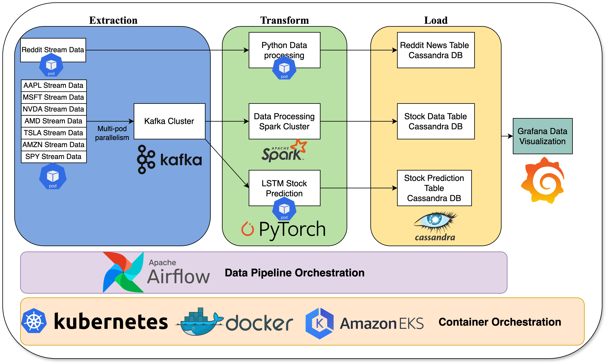

# Proyecto de Streaming de Acciones

## Descripción del Proyecto

* Este proyecto utiliza Python, Kafka y Spark para procesar datos de streaming en tiempo real provenientes de mercados de valores y Reddit. Emplea un modelo de aprendizaje profundo Long Short-Term Memory (LSTM) para realizar predicciones en tiempo real sobre datos de acciones SPY (ETF del S&P 500). Además, el proyecto utiliza Grafana para la visualización en tiempo real de datos de acciones, análisis predictivo y datos de Reddit, proporcionando una visión general completa y dinámica de las tendencias del mercado y los sentimientos.

### Demostración


### Estructura del Proyecto



## Herramientas

1. Apache Airflow: Orquestación de pipelines de datos
   1. Operadores Kubernets/Bash/Python
   2. Variables
2. Apache Kafka: Manejo de datos en streaming
   1. Topic, partición, productor, consumidor
3. Apache Spark: Procesamiento de datos por lotes
   1. Structured streaming
4. Apache Cassandra: Base de datos NoSQL para almacenar datos de series temporales
5. Docker + Kubernets: Contenerización y Orquestación de Docker
6. AWS: Amazon Elastic Kubernetes Service (EKS) para ejecutar Kubernets en la nube
7. Pytorch: Modelo de aprendizaje profundo
8. Grafana: Visualización de datos en streaming

## Elecciones de Diseño del Proyecto

### Kafka

* ¿Por qué Kafka?
  * Kafka sirve como manejador de datos en streaming para alimentar datos a Spark y al modelo de aprendizaje profundo
* Diseño de Kafka
  * Inicializo múltiples operadores k8s en airflow, donde cada operador k8s corresponde a una sola acción, por lo tanto el sistema puede producir datos de acciones simultáneamente, mejorando el rendimiento aprovechando el paralelismo. En consecuencia, particiono el tema según el número de acciones, permitiendo que cada hilo dirija sus datos a una partición distinta, optimizando así el flujo de datos y maximizando la eficiencia

### Diseño de la Base de Datos Cassandra

* Los datos de acciones contienen la información del símbolo de `stock` y el `utc_timestamp`, que pueden usarse para identificar de forma única un punto de datos individual. Por lo tanto, uso esas dos características como clave primaria
* Uso `utc_timestamp` como clave de clustering para almacenar los datos de series temporales en orden ascendente para una lectura eficiente (lectura secuencial de datos de series temporales) y escrituras de alto rendimiento (los datos en tiempo real solo se añaden al final de la partición)

### Discusión del Modelo de Aprendizaje Profundo

* Datos
  * Dimensión de Datos de Entrenamiento (N, T, D)
    * $N$ es el número de datos en un lote
    * $T=200$ mirar hacia atrás datos de doscientos segundos
    * $D=5$ las características en los datos (precio, número de transacciones, precio máximo, precio mínimo, volúmenes)
  * Dimensión de Datos de Predicción (1, 200, 5)
* Estructura del Modelo:
  * X->[LSTM * 5]->Lineal->Predicción de Precio
* Cómo Funciona el Modelo:
  * En la marca de tiempo actual $t$, obtener los últimos 200 datos de serie temporal antes de $t$ en orden ascendente de `utc_timestamp`. Alimentar los datos en el modelo de aprendizaje profundo que predecirá el precio actual de la acción SPY en el tiempo $t$.

* Debido a los recursos computacionales limitados en mi máquina local, la predicción "en tiempo real" se retrasa respecto al tiempo real debido a la larga duración de la computación requerida.

## Direcciones Futuras

1. Usar Terraform para inicializar la infraestructura en la nube automáticamente
2. Usar Kubeflow para entrenar el modelo de aprendizaje profundo automáticamente
3. Entrenar un mejor modelo de aprendizaje profundo para hacer predicciones más precisas y rápidas

## Instalación

### Requisitos

1. `python3`
2. `Docker` está en ejecución y `K8S` está en ejecución
3. `Helm` está instalado en la computadora local
4. `Dockerhub`
5. [Stock API Key](https://polygon.io/) (No es gratuita)
6. [Reddit API Key](https://www.reddit.com/prefs/apps)
7. Cuenta de AWS si deseas desplegar en AWS

### Desplegar en Amazon Web Service

1. En el directorio raíz del proyecto, ejecuta `env.py` para generar el archivo de entorno en el directorio raíz del proyecto
2. En la terminal, ejecuta `aws configure` para configurar la línea de comandos de AWS
3. En [IAM](https://us-east-1.console.aws.amazon.com/iam), asegúrate de tener los siguientes roles
   1. rol eks
   2. rol ec2
4. En [EKS](https://us-west-1.console.aws.amazon.com/eks/home), inicializa el clúster
5. Inicializa el grupo de nodos con 6 nodos `c3.xlarge` con arquitectura x86-64
6. Añade el `Amazon EBS CSI add-on` al clúster siguiendo las [Instrucciones de AWS](https://docs.aws.amazon.com/eks/latest/userguide/managing-ebs-csi.html)
7. En la terminal, ejecuta `aws eks update-kubeconfig --region <region> --name <cluster_name>`. Asegúrate de que el contexto actual de kubectl sea eks ejecutando `kubectl config get-contexts` en la terminal.

#### Construir el Proyecto (arquitectura x86-64)

```bash
make k8s-kafka
make k8s-cassandra
make k8s-spark
make k8s-kafka-dashboard
make k8s-data-dashboard
make k8s-dashboard
```

Para cada línea de comando en el siguiente fragmento de código, ejecútala en diferentes terminales bajo el directorio raíz:

```bash
cd k8s/cassandra  && make cassandra-cluster-local-connection
cd k8s/kafka-dashboard && make kafka-dashboard-port-forward
cd k8s/spark && make spark-port-forward
cd k8s/grafana && make grafana-port-forward
make k8s-airflow-amd64 # Esto tomará ~10-20min para instalar
```

### Desplegar On-Premise

#### Construir el proyecto:

1. En el directorio raíz del proyecto, ejecuta `env.py` para generar el archivo de entorno en el directorio raíz del proyecto
2. Ejecuta los siguientes comandos y espera a que todos los comandos terminen:

```bash
make k8s-kafka
make k8s-cassandra
make k8s-spark
make k8s-kafka-dashboard
make k8s-data-dashboard
make k8s-dashboard
```

3. Para cada línea de comando en el siguiente fragmento de código, ejecútala en diferentes terminales bajo el directorio raíz:

```bash
cd k8s/cassandra  && make cassandra-cluster-local-connection
cd k8s/kafka-dashboard && make kafka-dashboard-port-forward
cd k8s/spark && make spark-port-forward
cd k8s/grafana && make grafana-port-forward
make k8s-airflow-arm64 # Cambia esto a make k8s-airflow-amd64 si estás usando arquitectura x86-64
```

### Acceder a los Recursos de K8S

1. [k8s-dashboard](http://localhost:8001/api/v1/namespaces/kubernetes-dashboard/services/https:kubernetes-dashboard:/proxy/.) para el monitor del clúster de Kubernets
2. [Airflow](http://localhost:10001) (usuario: admin, contraseña: admin) para la generación y consumo de datos en tiempo real.
3. [kafka-ui](http://localhost:10000): monitorear el estado del clúster de Kafka.
4. [spark-ui](http://localhost:10001): monitorear el estado del clúster de Spark.
5. [Grafana](http://localhost:3000): Visualización de Datos
   1. usuario: admin
   2. contraseña: admin123

### Visualización de Datos:

* En [Grafana](http://localhost:3000), añade una conexión de datos con el proveedor `Apache-Cassandra` (Asegúrate de que el pipeline de datos haya comenzado)
  * host: `cassandra.cassandra-cluster.svc.cluster.local:9042`
  * keyspace: `stock`
  * usuario: cassandra, contraseña: cassandra
* Importa el dashboard importando [dashboard.json](./k8s/grafana/dashboard.json). Recuerda actualizar la **fuente de datos** en cada panel y cambiar el **rango de tiempo**

### Desinstalar el Proyecto

* En el directorio raíz del proyecto, ejecuta `make clean`

## Estructura de Archivos

```bash
.
├── Makefile
├── README.md
├── README_Resources
│   ├── demo.gif
│   └── project-architecture.png
├── docker-service
│   ├── airflow
│   │   ├── Dockerfile
│   │   ├── dags
│   │   │   ├── real_time_stock_consume.py
│   │   │   └── real_time_stock_data_generation.py
│   │   ├── python_requirements.txt
│   │   └── scripts
│   │       ├── cassandra_table_creation.py
│   │       ├── kafka_topic_creation.py
│   │       └── spark
│   │           └── spark_stream_processing.py
│   ├── python_reddit
│   │   ├── Dockerfile
│   │   ├── python_requirements.txt
│   │   └── reddit-producer.py
│   ├── python_stock
│   │   ├── Dockerfile
│   │   ├── python_requirements.txt
│   │   └── stock_data_generation
│   │       ├── single_stock_generator.py
│   │       ├── stock_generation_script.py
│   │       └── stock_generator.py
│   └── python_stock_prediction
│       ├── Dockerfile
│       ├── lstm_model
│       │   ├── lstm_model.py
│       │   ├── lstm_model_weights.pth
│       │   ├── lstm_prediction.py
│       │   └── scaler.save
│       └── python_requirements.txt
├── env.py
└── k8s
    ├── airflow
    │   ├── Makefile
    │   └── values.yaml
    ├── cassandra
    │   ├── Makefile
    │   └── values.yaml
    ├── grafana
    │   ├── Makefile
    │   ├── dashboard.json
    │   └── values.yaml
    ├── k8s-dashboard
    │   ├── Makefile
    │   └── dashboard-adminuser.yaml
    ├── kafka
    │   ├── makefile
    │   └── values.yaml
    ├── kafka-dashboard
    │   ├── makefile
    │   └── values.yml
    └── spark
        ├── Makefile
        └── values.yaml
```
